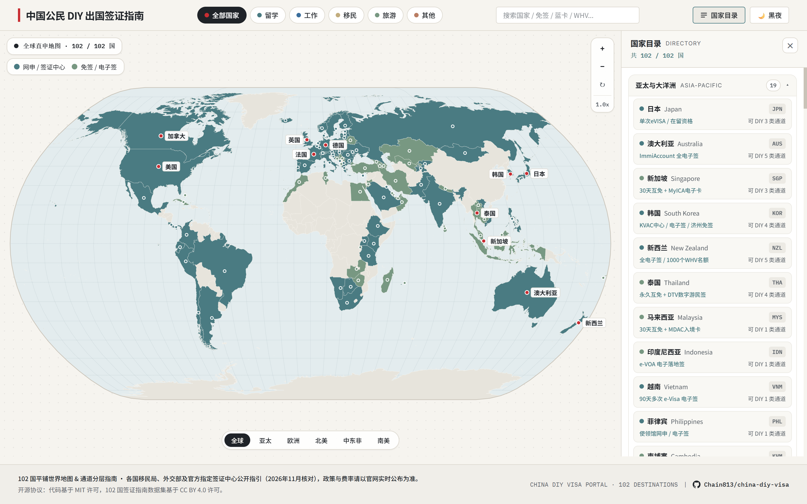
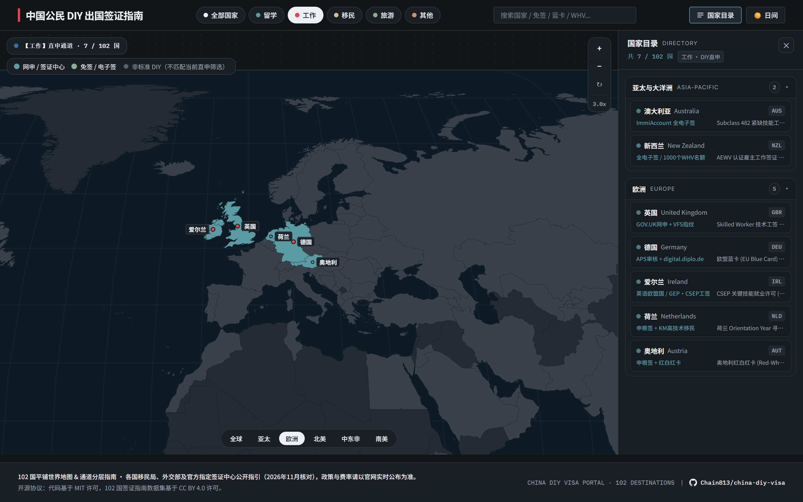
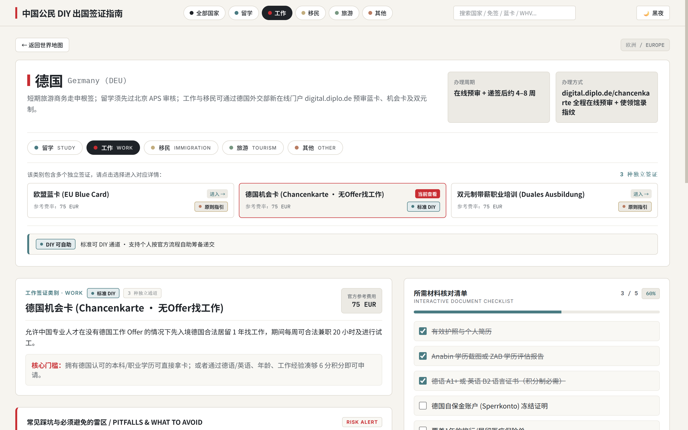
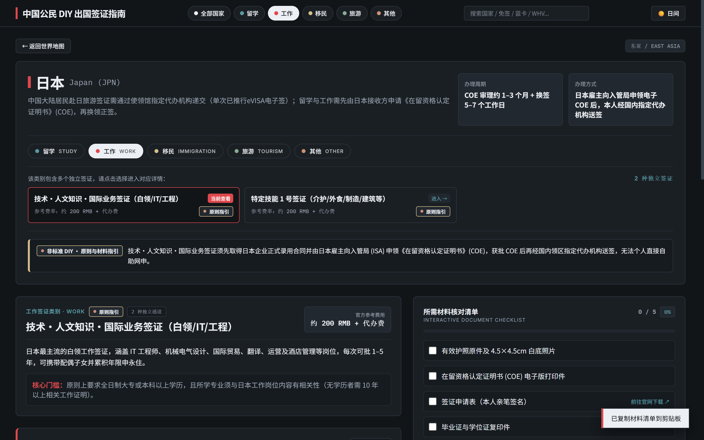
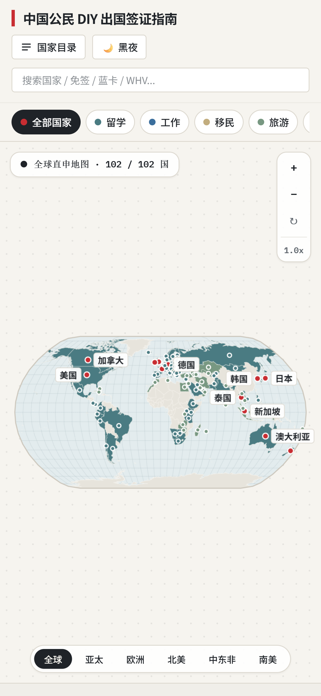
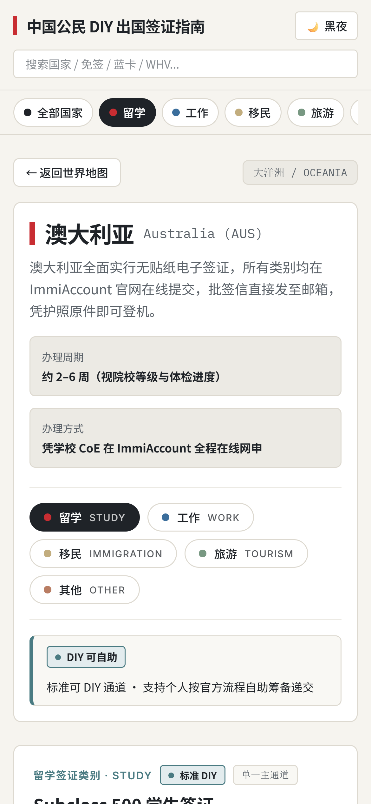

# 中国公民 DIY 出国签证指南 (`china-diy-visa`)


面向中国大陆普通护照持有者的 DIY 出国签证全流程参考指南，覆盖全球 **102 个国家与地区**、**五大签证通道（留学 / 工作 / 移民 / 旅游 / 探亲与商务其他）**，内置基于 `d3.geoNaturalEarth1()` + `d3.zoom()` 的平铺交互式 50m 世界地图与可折叠国家目录工作台，支持 DIY 可行性严格分层、子签证动态办理周期与递交方式、时间线流程、避坑提醒、官方直达入口及可持久化材料核对清单。

> 在线体验（中国大陆直连）：[www.jiyan.ink/visa/](https://www.jiyan.ink/visa/) ｜ 参考站点：[china-diy-visa.routeking.workers.dev](https://china-diy-visa.routeking.workers.dev/)

<p align="center">
  
</p>

---

## 界面预览（Screenshots）

### 桌面端：黑夜筛选 & 分层详情工作台

| 黑夜模式 · 「工作」DIY 严格筛选 + 欧洲 3.0x 聚焦 | 德国机会卡（Chancenkarte）· 标准 DIY 与材料进度 |
| :---: | :---: |
|  |  |

### 分层严谨性展示：区分「标准 DIY」与「仅作原则指引」

> 拒绝“所有渠道都能纯自助”的虚假宣传——如日本工签需雇主前置申领《在留资格认定证明书 (COE)》，系统会明确标橙提示 `非标准 DIY · 原则与材料指引`。

<p align="center">
  
</p>

### 移动端竖屏自适应（Zero Horizontal Overflow）

| 移动端地图首屏（完整露出大洲快捷栏） | 移动端国家详情 Bento（2026 调价动态展示） |
| :---: | :---: |
|  |  |

---

## 核心特性

- **平铺 50m 交互式世界地图与可折叠国家目录**：
  - 使用本地内置的高精度 50m TopoJSON 世界地图（[`public/world-50m.json`](public/world-50m.json)，含 241 个几何多边形，完整补全新加坡、毛里求斯与巴林轮廓），无外部地图 CDN 运行时依赖。
  - HiDPI Canvas 渲染，支持 `1.0x` – `8.0x` 滚轮/双指/按钮平滑缩放与边界受控拖拽平移、六大区域快捷聚焦、微距点击飞入动画、三大 DIY 状态着色（标准 DIY 可申 / 仅原则提示 / 筛选置灰），以及桌面端侧栏与移动端可折叠的四大地理区域国家目录工作台（支持键盘浏览与底图加载异常兜底）。
- **首屏索引 + 按大洲懒加载数据架构**：
  - 首屏仅加载轻量 [`COUNTRY_DIRECTORY`](src/data/directory.ts)，按亚太、欧洲、美洲、中东与非洲四个独立片区动态 `import()` 懒加载详情数据（[`src/data/regions/`](src/data/regions/)），将首屏主包控制在 `500 kB` 以内。
  - 区分 **标准可 DIY (`'diy'`)** 与 **原则与材料指引 (`'advisory'`)** 通道，并在 [`SubVisaItem`](src/types/visa.ts) 下沉子签证级办理周期、递交方式与指引说明，彻底消除跨通道信息错配与伪拆卡。
- **材料核对清单与明暗双主题**：
  - 材料勾选状态与深浅主题偏好自动持久化到 `localStorage`（兼容键名 `china_diy_visa_checklist_v1`、`china_diy_visa_theme_v1`），支持完成百分比与进度条统计、作用域精准匹配的官方申请表下载入口、一键复制纯文本清单（含 `textarea` 降级）与重置当前子签证进度；黑夜模式适配高对比度反转 Toast 提示与自适应 Bento 卡片。
- **独立 SPA URL 路由与动态标题**：
  - 支持首页分类筛选 `/?cat=work`、国家详情直达与分享 `/country/JPN?tab=work&sub=gijinkoku`（国家代码大小写不敏感），动态更新 `document.title`，返回地图首页时自动清理旧搜索词并提示，内置 `RouteErrorBoundary` 与无效路径回退保护。
- **可访问性（A11y）**：
  - 全局搜索框具备 WAI-ARIA `combobox` / `listbox` / `option` 完整键盘上下键选人与 `Tab` 失焦收起；国家详情页标签页支持键盘方向键切换（`ArrowLeft` / `ArrowRight` / `Home` / `End`）与进度/状态实时无障碍播报。

---

## 技术栈

- **框架与路由**：React 19、TypeScript、React Router v7 (`React.lazy` + `Suspense`)
- **构建与样式**：Vite 6、Tailwind CSS v3 + CSS Variables
- **地图与几何**：D3 (`d3-geo` / `d3-zoom` / `d3-selection` / `d3-transition`)、`topojson-client`、`world-atlas` (`50m`)
- **测试体系**：Vitest + `@testing-library/react` + `jsdom`（覆盖 102 国数据分层与懒加载、Hooks/工具、布局与键盘检索、平铺 50m 地图与目录交互、国家详情 Bento 与路由并发状态同步）
- **部署目标**：Cloudflare Workers Static Assets（配置见 [`wrangler.jsonc`](wrangler.jsonc)）

---

## 目录结构

```text
china-diy-visa/
├── deploy/
│   └── nginx/
│       └── visa.conf                   # Nginx 子路径（/visa/）独立托管配置片段
├── docs/
│   └── screenshots/                    # README 实机高清演示截图
├── public/
│   └── world-50m.json                  # 本地内置 50m 世界地图 TopoJSON（241 个多边形）
├── src/
│   ├── types/visa.ts                   # 核心数据结构与 CountrySummary / SubVisaItem 类型定义
│   ├── data/
│   │   ├── categories.ts               # 签证分类与明暗主题配色
│   │   ├── directory.ts                # 102 国首屏轻量索引（坐标、徽章、DIY 分类与检索语料）
│   │   ├── index.ts                    # 轻量筛选与按大洲动态 import() 懒加载器
│   │   └── regions/                    # 102 国详情分片数据（asia-pacific / europe / americas / middle-east-africa）
│   ├── hooks/
│   │   ├── useTheme.ts                 # 明暗主题切换与 localStorage 同步
│   │   └── useChecklist.ts             # 材料清单勾选状态管理与格式化文本导出
│   ├── utils/
│   │   ├── basePath.ts                 # 基于 import.meta.env.BASE_URL 的路由 basename 与静态资源路径解析
│   │   ├── formLinks.ts                # 按国家 code 严格限定作用域的官方申请表匹配
│   │   └── worldAtlas.ts               # 50m TopoJSON 解析、校验与缓存加载
│   ├── components/
│   │   ├── layout/                     # Header、SearchDropdown、Footer、Toast
│   │   ├── map/                        # WorldMapView、MapCanvas、mapRenderer、mapHitTest、MapOverlays、CountryDirectory
│   │   └── country/                    # CountryDetailView 与详情 Bento 卡片组件
│   ├── App.tsx                         # SPA 路由、懒加载兜底、ErrorBoundary 与转场状态协调
│   ├── main.tsx                        # 应用入口（BrowserRouter）
│   └── index.css                       # 主题 CSS 变量、100dvh 舞台、时间线与动画样式
├── tests/                              # Vitest 单元与集成测试套件
├── index.html                          # 页面模板（无外部字体 CDN 请求 + 内联 SVG 图标）
├── wrangler.jsonc                      # Cloudflare Workers Static Assets 配置
├── package.json
├── tailwind.config.js
├── tsconfig.json
└── vite.config.ts
```

---

## 本地开发与验证

需要 **Node.js 18+**（建议 Node 20+）及 npm。

```bash
# 1. 安装依赖
npm install

# 2. 启动本地开发服务器
npm run dev

# 3. 严格类型检查
npm run typecheck

# 4. 运行全部自动化测试
npm test

# 5. 构建根路径 / 生产产物（输出至 dist/）
npm run build

# 6. 构建子路径 /visa/ 生产产物（适用于 Nginx 子路径直连部署）
npm run build:visa

# 7. 本地预览生产环境产物
npm run preview
```

---

## 部署说明

### 方式一：自有服务器 / Nginx 子路径部署（支持中国大陆直连）

项目已移除外部 Google Fonts 请求，所有路由与 `world-50m.json` 均支持通过 `import.meta.env.BASE_URL` 适配子路径（当前实机线上站点：`https://www.jiyan.ink/visa/`）：

```bash
# 构建 --base=/visa/ 产物
npm run build:visa
```

搭配 [`deploy/nginx/visa.conf`](deploy/nginx/visa.conf) 将静态产物挂载至 `/var/www/china-diy-visa/visa/`，即可在不影响宿主主站的情况下实现 `/visa/` SPA 路由直达与长期静态缓存。

### 方式二：部署到 Cloudflare Workers

项目同时保留 [`wrangler.jsonc`](wrangler.jsonc)（启用 `not_found_handling: "single-page-application"` 以支持 `/country/:code` 刷新直达）：

```bash
npm run build
npx wrangler deploy
```

---

## 免责声明

本站整理的签证流程、费用、材料清单与官方网址（截至 2026 年 11 月公开指引校对）仅作出行前自助准备参考。各国出入境政策、申请费率与递签规则可能随时调整，正式递签前请务必以目的国使领馆、移民局及官方指定签证中心官网实时公告为准。

---

## 开源协议与使用署名规范（Licensing & Attribution）

本项目采用**代码与内容双许可**模式，具体范围如下：

| 范围 | 目录 / 文件 | 适用协议 | 核心要求 |
| :--- | :--- | :--- | :--- |
| **应用程序源代码** | `src/` 下除 `src/data/` 外的全部代码、样式、测试与构建配置 | [MIT License](LICENSE) | 保留原作者版权声明与 MIT 许可声明 |
| **102 国签证数据与攻略文案** | [`src/data/`](src/data/)、[`docs/`](docs/) | [CC BY 4.0（署名 4.0 国际）](LICENSE-DATA)（[协议全文](https://creativecommons.org/licenses/by/4.0/)） | 使用、转载、二次整理或公开展示**必须注明来源并说明是否修改** |
| **完整声明文件** | [`NOTICE`](NOTICE) | — | 分发或二次部署时须保留 [`NOTICE`](NOTICE) 归属说明 |

### 注明来源（Attribution）要求

无论是基于本项目源码进行**公开网站部署 / 二次开发**，还是引用、转载、封装本项目中的 **102 国签证通道步骤、避坑提醒或材料清单数据**，均须在显眼位置（如网页页脚、项目 README、文章末尾或致谢说明）注明以下来源信息（如做过改动，请一并标明）：

- **原作者**：`RouteKing`
- **开源仓库**：`https://github.com/Chain813/china-diy-visa`
- **在线原站**：`https://china-diy-visa.routeking.workers.dev/`

#### 可直接使用的署名示例

**Markdown 格式：**
```markdown
数据与源码来源：[china-diy-visa](https://github.com/Chain813/china-diy-visa)（作者：RouteKing，原站：https://china-diy-visa.routeking.workers.dev/），内容基于 CC BY 4.0 协议、代码基于 MIT 协议使用。
```

**HTML 页脚格式：**
```html
<span>
  来源：<a href="https://github.com/Chain813/china-diy-visa">china-diy-visa</a> by RouteKing（代码 MIT / 数据 CC BY 4.0）
</span>
```
